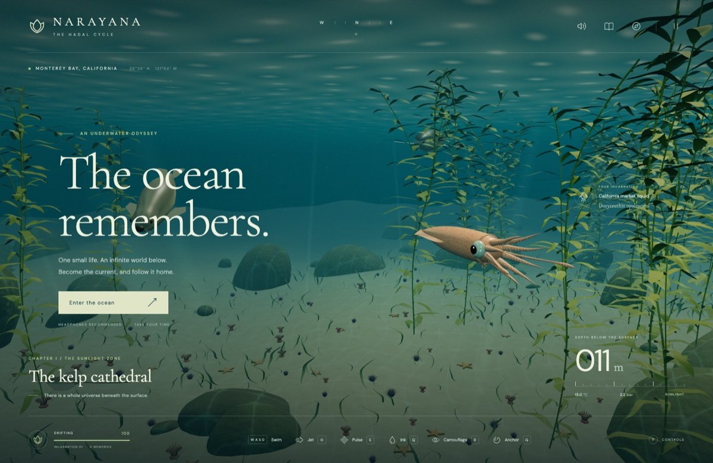

# NARAYANA — The Hadal Cycle



A playable Three.js underwater adventure based on [plan.txt](plan.txt) and [the gamification design](docs/gamification.txt). Three separate experiences are preserved: **Original open ocean**, **Original trench**, and **Terraced descent**. Each keeps its own location, discoveries, victories and progression; preferences, turbo and UV controls are shared.

## Play

```sh
npm install
npm run dev
```

Open **http://localhost:5177** and click **Enter the ocean**. New players begin in the original open world. Use **◇ Choose ocean experience** in the top bar, the title screen, or the pause menu to switch journeys. **M** opens the atlas for the selected experience.

- **Original open ocean:** the original Monterey world and all seven depth zones, including the second-level Monterey Canyon. Free atlas travel, original terrain, sanctuaries and side habitats.
- **Original trench:** the earlier flat chamber layouts, dolphin course, canyon, caves, temples, wrecks, Titanic, city and hollow-earth finale. All twelve preserved regions are available; a new journey starts in the canyon.
- **Terraced descent:** a separate route with six descending ledges per region, five activities, the blue squid guide and sequential unlocks. The city is an optional bonus.

Hold **Shift** for turbo travel; release to brake. **Y** selects turbo or precision jets. **V** toggles UV vision; **[ / ]** and the UV gain slider adjust visibility. **P** toggles the spotlight.

```sh
npm test
npm run build
npm run preview
```

For browser checks, install Chromium with `npx playwright install chromium` and keep the development server running:

- `npm run test:experiences`: switches among all three worlds, verifies their distinct layouts, saved locations, shared preferences and mobile selector.
- `npm run test:browser` / `npm run test:expedition`: a full terraced current course, locked atlas, optional city, passage travel, measured turbo acceleration and braking, UV controls, saved settings, every space and mobile layout.
- `npm run test:hunt`: prey capture, feeding, repeated attacks, octopus anatomy, swim speed, spectral perception and saved catches.
- `npm run test:combat`: enemy attack chains, evasion, sweep, ink, saved victories, habitat observation and mobile controls.

`GAME_URL` and `PLAYWRIGHT_CHROMIUM_EXECUTABLE` can select another server or browser. Screenshots go to `artifacts/`. `scripts/playtest.mjs` retains the earlier free-atlas prototype's checks; the active browser command tests the current expedition.

## Controls

| Input                   | Action                                                                                                           |
| ----------------------- | ---------------------------------------------------------------------------------------------------------------- |
| WASD                    | Swim; crawl while anchored                                                                                       |
| Mouse / arrow keys      | Steer                                                                                                            |
| Shift                   | Hold for sustained turbo jets; release to brake                                                                                              |
| Y                       | Select turbo / precision mantle jets                                                                             |
| [ / ] / UV gain slider  | Adjust UV vision brightness and visibility through dark water                                                     |
| Space / C / Ctrl        | Ascend / descend                                                                                                 |
| X / left click / Attack | Grab small prey, or chain attacks against a nearby enemy; hold to repeat                                         |
| L / Focus               | Focus the nearest visible enemy; press again to release                                                          |
| Z / Evade               | Sideways jet dodge; A + Z dodges left                                                                            |
| B / Sweep               | Eight-arm sweep with stagger and knockback                                                                       |
| Shift + attack          | Jet ram                                                                                                          |
| Q / Ink                 | Distract nearby enemies and create an ink ambush                                                                 |
| **P / light button**    | **Toggle the forward dive spotlight**                                                                            |
| E                       | Sonar pulse: discover life, free trapped shoals, answer echo seals, survey memorial beacons and restore habitats |
| R                       | Chromatophore camouflage                                                                                         |
| G / right click         | Anchor to a nearby surface or release                                                                            |
| F                       | Enter an open passage; interact with instruments, sanctuaries or rideable wildlife                               |
| H                       | Observe restored habitat wildlife for six quiet seconds; movement cancels                                        |
| V                       | Toggle fictional UV squid vision: fluorescence and enhanced visibility                                                   |
| T                       | Switch squid / octopus                                                                                           |
| J / M / Esc             | Journal / expedition atlas / pause                                                                               |

Gamepads: left stick swims, right stick looks, A/B rise/dive, RT jets, LT attacks, X releases ink, Y pulses, LB camouflages, RB interacts, L3 evades, R3 focuses; D-pad up sweeps, down observes and left toggles the light. Touch controls include attack, evade, sweep, focus, ink and a persistent light button; drag the ocean to look.

The spotlight follows your gaze, lights nearby surfaces and clips its visible cone at walls. It has no battery limit. Higher quality settings enable spotlight shadows; Low omits them. Sound, volume, look sensitivity and reduced camera movement are configurable.

## Terraced expedition

| Space                         |                                 Depth | Environment and passage objective                                                                    |
| ----------------------------- | ------------------------------------: | ---------------------------------------------------------------------------------------------------- |
| Bonus: drowned metropolis     |                                  18 m | Optional prototype, preserved for a later visual rebuild; three shoal rescues |
| The living reef               |                                  35 m | Kelp terraces, crab gardens, schooling fish and the blue squid; descend through five currents                        |
| The vertical blue             |                                 360 m | High cliff walls and strong directional currents; follow the ordered rings                           |
| The ship graveyard            |                                 850 m | Open freighter hulls, companionways and debris; find echo seals                                      |
| The singing caverns           |                               1,800 m | Open-ended basalt tunnels with physical walls and ceilings; answer numbered sonar crystals           |
| The tidal temple              |                               2,800 m | Terraced palace, circular colonnade, aqueducts and arches; awaken temple resonators                  |
| Titanic · the silent Atlantic |         **3,810 m / about 12,500 ft** | Separated bow and stern, open hull, rails, boilers, rusticles and debris; record memorial beacons    |
| The abyss in bloom            |                               4,300 m | Sponge fields and drifting life; release trapped shoals                                              |
| The earth is breathing        |                               6,600 m | Black smokers, mineral chimneys and ascending currents; complete the course                          |
| The cathedral of tides        |                               8,500 m | Violet Nāga halls and mineral gardens; awaken moonstone resonators                                   |
| The inner ocean               | Mythic, entered below Challenger Deep | Extreme cliffs and luminous arches; follow the inward current                                        |
| The heart of the hollow earth |                                Mythic | Dark sphere, animated accretion disk and final echo seals; enter the event horizon                   |

Sonar seals require proximity and line of sight. Current rings require physical passage in order. Progress, opened spaces, victories and the light setting persist. Legacy saves migrate to the matching experience: original world, earlier expedition, or terraces. Switching experiences snapshots the outgoing journey and resumes the destination without resetting either. The seven underlying ocean depth bands remain in place beneath the eleven descents and bonus city. Each main region has six landings spaced 42 metres along the trench and 18 metres downward, five ordered activities, and a final passage. Current checks use swept motion so turbo cannot skip a ring between frames. Whale crossings and shoal movements accompany the route. The displayed depths are region entry depths; the terraces descend further within each region.

The flooded city, relocation between oceans, Atlantis, hollow earth and black-hole ending belong to the fictional setting. Titanic is an original procedural interpretation at the requested depth, not a survey-accurate reconstruction or a geographically continuous extension of Monterey Canyon. The inner-earth spaces use compact playable arenas beyond the trench gateway, not a literal geological model.

## Animals and combat

The squid has a tapered mantle, paired fins, eight arms, two feeding tentacles, lateral eyes, a siphon and individual suckers. Octopus uses eight arms and its own body shape. Locomotion integrates fin forces, charged jets, drag, buoyancy, currents and arm anchors. Squid cruise at roughly 7.4 m/s. Selectable fictional turbo sustains 48 m/s for squid and 40 m/s for octopus, with stronger steering and release braking. Precision mode retains short biological mantle bursts. This is an anatomical and physical approximation, not a scientific fluid simulation.

Squid feeding clubs reach about 3.2 metres beyond the mouth, capture a real fish, reel it into the arm crown and feed with animated beak bites. Octopus uses a shorter ordinary-arm capture. Rewards arrive after feeding; cancellation releases the same animal. Creature growth updates anatomy and reach together.

The expedition distributes **55 patrol encounters** across its spaces, including more shallow scuba hunters, piloted hunter submersibles, sharks and whale guardians. Hunters telegraph aimed shots; sharks commit to lunges and recover afterward; whale encounters use fictional expanding pressure waves. Hold Attack for **tentacle lash → crosscut → beak rush**, evade for a counter window, use ink for an ambush, or stagger enemies with an arm sweep. Terrain blocks strikes and projectiles. Victories persist and cannot award duplicate memories.

Ambient seals, sea lions, otters, rays, whales, schooling fish and deep organisms continue to inhabit their depth bands. Restorative side habitats and quiet observation remain available alongside the new passage objectives. Procedural schools, benthos, vegetation, marine snow and currents accompany the architecture. Models, materials and sound effects are original procedural work.

## Scope and structure

The renderer uses WebGL 2. The current expedition substantially extends the playable build; the larger design still includes future work such as a volcanic-island prologue, moving multi-anchor grapples, broader biological ability trees, multi-stage leviathan bosses and further production asset/audio polish.

`src/expedition` owns both the preserved classic layouts and the separate terraced route. The original open world runs without an expedition terrain overlay. `src/core/SaveSystem.js` owns the three independent journey slots. `src/player` owns anatomy, locomotion, feeding and the dive lamp; `src/combat` owns enemy encounters. `src/world`, `src/ocean` and `src/ecology` own terrain, water and wildlife. `src/core/Game.js` integrates them with the HUD and audio.

The current implementation and remaining ambitions from `docs/gamification.txt` are tracked in [the descent work notes](docs/DESCENT_WORK.md). The city rebuild is explicitly deferred in [the bonus city backlog](docs/CITY_BONUS_BACKLOG.md).

See [sources and asset notes](docs/SOURCES.md) for reference links and provenance.

See [experience preservation notes](docs/EXPERIENCES.md) for the live layouts, save migration and the archived terraced build.

## License

Code: MIT (`LICENSE`). Original procedural assets: CC BY 4.0
(`ASSET-LICENSE.md`). Third-party components: `THIRD_PARTY.md`.
